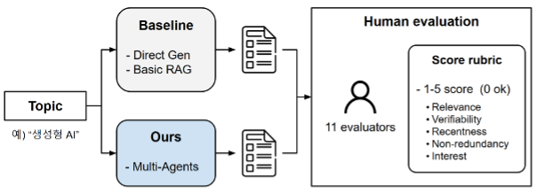

# 📰 AI News Curator

> 서울과학기술대학교 인공지능응용학과
> Capstone Design II (2024, 2인 팀)
>
> 관점이 다른 가상 구독자의 투표를 통해, 관련성뿐 아니라 **화제성(Trendiness)**까지 반영하는 멀티에이전트 AI 뉴스레터


---

# 📖 Overview

LLM 기반 뉴스 요약 서비스는 대부분 검색 결과 중 **질문과 관련 있는 기사**를 골라 요약합니다. 하지만 관련 있는 기사가 꼭 사람들이 읽고 싶어 하는 기사는 아닙니다.

이 프로젝트는 **"관점이 다른 여러 독자가 공통으로 고른 기사일수록 많은 사람이 관심을 가질 기사"**라는 가정에서 출발했습니다.

- ML 엔지니어, 연구자, 기자, 기획자 관점의 가상 구독자(페르소나)가 각자 읽고 싶은 기사를 고르고
- 여러 명이 겹쳐 고른 기사를 우선 선정한 뒤
- 선정된 기사의 원문을 요약해 뉴스레터를 만듭니다.

제안 방식을 검색 없는 생성(Direct Generation), 일반적인 검색 기반 생성(Basic RAG)과 비교해 사람 평가로 관심도를 측정했습니다.

---

# ✨ Features

- 🔍 **뉴스 검색**: DuckDuckGo 뉴스 검색으로 주제 · 기간에 맞는 기사 수집
- 🗳 **가상 구독자 투표**: 4개 페르소나가 각자 기사를 고르고, 고른 사람 수와 순위 점수(Borda count)로 집계
- 🔒 **원본 보존**: LLM은 기사 **번호만** 고르고, 제목 · 출처 · URL은 검색 결과 원본을 그대로 사용
- ✍️ **원문 기반 요약**: 기사 원문을 가져와 한국어 3문장으로 요약 (원문을 못 가져오면 검색 본문 사용)
- 🔗 **LangGraph 파이프라인**: 검색 → 선별 → 요약을 그래프 노드로 연결
- 📏 **비교 실험**: Direct Generation, Basic RAG(tool calling 에이전트) baseline 구현
- 📊 **평가**: 사람 평가(11명) + LLM-as-a-judge 채점 스크립트
- 💻 **Streamlit 데모**: 방식별 데모 화면

---

# 🏗️ System Architecture

<p align="center">

</p>

위 그림은 연구 설계 단계의 전체 구조도입니다. 그중 사전 설문(Pre-survey) 단계는 현재 저장소에 포함되어 있지 않습니다.

현재 코드의 파이프라인은 다음과 같습니다.

```
topic, interests, period
        │
     [search]   DuckDuckGo 뉴스 검색 (최대 15개)
        │
     [curate]   가상 구독자 4명이 각자 5개씩 기사 번호 선택
        │       dev / researcher / journalist / pm
        │       → 고른 사람 수 → 순위 점수(Borda) 순으로 정렬, 상위 N개
        │
     [edit]     선택된 기사 원문을 가져와 한국어 3문장 요약
        │
  Markdown Newsletter
```

각 노드는 같은 상태(dict)를 받아 자기 결과 필드(`trending_articles`, `selected`, `newsletter`)를 추가해 다음 노드로 넘기는 구조입니다.

### 비교 방식

| 방식 | 설명 | 코드 |
| --- | --- | --- |
| Direct Generation | 검색 없이 LLM이 바로 뉴스레터 작성 | `lib/baseline/direct_gen.py` |
| Basic RAG | 뉴스 검색 도구를 쓰는 tool calling 에이전트 | `lib/baseline/basic_rag.py` |
| **Multi-Agent (ours)** | 검색 → 가상 구독자 선별 → 요약 (LangGraph) | `lib/agents/` |

---

# ⚙️ Tech Stack

| Category | Technology |
| --- | --- |
| Language | Python 3.11 |
| LLM | OpenAI GPT-3.5 Turbo (선별 · 요약 · 생성), GPT-4 Turbo (평가 채점) |
| Framework | LangChain (LCEL, Tool Calling, Structured Output), LangGraph |
| Data Model | Pydantic |
| Search | DuckDuckGo News Search |
| Document Loader | LangChain WebBaseLoader |
| UI | Streamlit |

---

# 📂 Project Structure

```
ai-news-curator-main/ai-news-curator-main/
├── lib/
│   ├── agents/
│   │   ├── search.py          # 뉴스 검색 에이전트
│   │   ├── curator.py         # 가상 구독자 투표 · 집계
│   │   ├── editor.py          # 원문 요약 에이전트
│   │   └── master.py          # LangGraph 파이프라인, 뉴스레터 생성
│   ├── baseline/
│   │   ├── direct_gen.py      # Direct Generation
│   │   └── basic_rag.py       # Basic RAG (tool calling)
│   └── utils.py
├── app_multi_agent.py         # 제안 방식 데모
├── app_rag_newsletter.py      # Basic RAG 데모
├── app_rag_structured.py      # Basic RAG (구조화 출력) 데모
├── app_gen_newsletter.py      # Direct Generation 데모
├── evaluate.py                # LLM-as-a-judge 채점
├── score_rubric.json          # 채점 기준
├── eval_results/
├── notebook/                  # 검색 · RAG 초기 실험
└── requirements.txt
```

---

# 🚀 Workflow

### 1️⃣ Topic 입력

사용자가 주제, 관심사, 검색 기간(예: 1 Week)을 입력합니다.

↓

### 2️⃣ Web Search

검색 에이전트가 DuckDuckGo 뉴스 검색으로 후보 기사(제목, 본문 일부, 출처, 날짜, URL)를 수집합니다.

↓

### 3️⃣ Multi-Agent Voting

관점이 다른 가상 구독자 4명이 후보 기사 목록을 보고 각자 읽고 싶은 기사 5개를 고릅니다.

- LLM 출력은 Pydantic 모델(`Picks`)로 구조화해 **기사 번호 목록**만 받습니다.
- 잘못된 번호나 중복은 걸러냅니다.
- 고른 사람 수가 많은 순 → 같으면 각자 매긴 순위를 점수로 합산(Borda count)한 순으로 정렬합니다.
- 기사별로 몇 명이, 어떤 구독자가 골랐는지 함께 기록합니다.

↓

### 4️⃣ Summarization

요약 에이전트가 선정된 기사의 원문을 가져와 한국어 3문장으로 요약합니다. 원문을 가져오지 못하면 검색 결과의 본문으로 요약합니다.

↓

### 5️⃣ Newsletter Generation

선정 순서대로 제목, 요약, 출처 · 날짜, 관심 구독자 수, 링크를 Markdown 뉴스레터로 구성합니다.

---

# 📊 Experiment

## 사람 평가

평가자가 세 방식으로 만든 뉴스레터를 보고 평가했습니다.

<p align="center">

</p>

## LLM-as-a-judge

GPT-4 Turbo를 채점 모델로 두고, 루브릭(`score_rubric.json`)에 따라 1~5점으로 채점했습니다.

- 관련성 (Relevance)
- 최신성 (Recentness)
- 신뢰가능성 (Verifiability)
- 중복 (Non_redundancy)
- 관심도 (Interest)

결과를 분석하던 중 한계를 발견했습니다. 검색 없이 작성한 Direct Generation이 이미 오래된 소식(GPT-4 출시, Bard 공개)을 "최근 뉴스"로 썼는데도, 채점 모델은 최신성 5점을 줬습니다. 채점 모델이 실제 날짜나 사실을 확인하지 못하고 글의 형식만 보고 점수를 준 것입니다.

그래서 **LLM 자동 평가만으로는 부족하다고 판단하고 사람 평가를 함께 진행**했습니다.

---

# 📈 Result

| Method | Interest Score |
| --- | ---: |
| Direct Generation | 2.73 |
| Basic RAG | 2.64 |
| **Multi-Agent (ours)** | **3.36** |

<p align="center">

</p>

- 제안 방식의 관심도가 Basic RAG보다 **0.72점(약 27%)** 높았습니다.
- 평가자 수(11명)가 적어 통계적으로 유의하다고 보기는 어렵고, 방향성을 확인한 결과로 봅니다.

---

# 💻 Demo

<p align="center">

</p>

<p align="center">

</p>

```bash
cd ai-news-curator-main/ai-news-curator-main
pip install -r requirements.txt
export OPENAI_API_KEY=sk-...
streamlit run app_multi_agent.py
```

---

# 📌 Example Output

```markdown
# AI Newsletter   ← 입력한 주제 + " Newsletter"

## 1. (기사 제목)
(한국어 3문장 요약)
- 출처 · 날짜 · 관심 3명 (dev, researcher, pm)
- https://...

## 2. (기사 제목)
...
```

---

# 👨‍💻 My Role

### Multi-Agent Pipeline

- LangGraph로 검색 → 선별 → 요약 파이프라인 구성
- 가상 구독자 프롬프트 설계와 투표 · 집계 로직 구현
- 구조화 출력(Pydantic)으로 LLM은 선택만 하고 원본 데이터는 보존하도록 설계
- 원문 로딩과 요약 에이전트 구현

### Baseline

- Streamlit 데모 화면

---

# 💡 What I Learned

### LLM 평가

LLM 채점 모델이 그럴듯한 형식에 높은 점수를 준다는 것을 직접 확인했습니다. 자동 평가는 사람 평가나 사실 확인과 함께 써야 한다는 것을 배웠습니다.

---

### 멀티에이전트 설계

에이전트를 여러 개로 나누는 것보다 **에이전트 사이에 주고받는 데이터 형식을 먼저 정하는 것**이 중요하다는 것을 파이프라인을 연결하면서 느꼈습니다.

---

### LLM 출력 신뢰성

LLM에게 원본 데이터를 다시 쓰게 하면 제목이나 URL이 바뀔 수 있어, LLM에는 "선택"만 맡기고 데이터는 원본을 쓰는 설계가 더 안전하다는 것을 배웠습니다.

---

# 🚧 Limitations & Future Work

- 원문은 기사당 앞부분(약 3,000자)만 요약에 사용해 긴 기사는 뒷부분이 빠질 수 있음 → 청크별 요약 후 통합
- DuckDuckGo 검색은 요청 제한이 있고 내부 함수에 의존 → 공식 뉴스 API, 재시도 처리
- 가상 구독자를 순차 호출해 응답이 느림 → 병렬 호출
- 사전 설문(Pre-survey) 기반 페르소나 구성은 미구현 → 사용자 관심사로 페르소나 생성
- LLM 채점은 한 번만 수행 → 반복 채점으로 평균 · 편차 기록, 세 방식을 같은 인터페이스로 평가
- 화제성을 사람 평가의 관심도로만 측정 → 클릭률 등 실제 사용 데이터로 검증

---

# 📝 Note

개인 계정으로 저장소를 옮기는 과정에서 최종 버전이 아닌 중간 버전 코드가 올라간 것을 확인해, 2026년 11월 설계에 맞춰 멀티에이전트 부분(`lib/agents/`, `app_multi_agent.py`)을 추가했습니다. 위 실험 결과는 2024년 당시 결과이며, 추가한 코드로 다시 평가하지는 않았습니다.

---

# 👨‍💻 Team

| Name | Role |
| --- | --- |
| 홍승범 | Multi-Agent Pipeline, Baseline |
| 차승언 | Research Design, Evaluation |

---

# 📚 References

- LangChain
- LangGraph
- OpenAI API
- DuckDuckGo Search
- Streamlit
- Prometheus: Inducing Fine-grained Evaluation Capability in Language Models

---

# 📄 License

This project was developed as part of **Capstone Design II** at **Seoul National University of Science and Technology (SeoulTech)**.
For academic purposes only.
