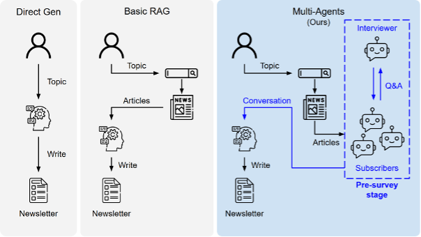
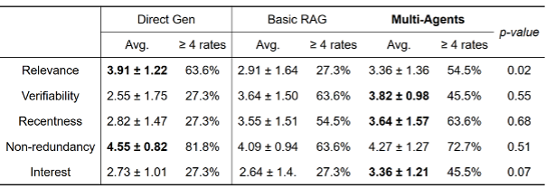
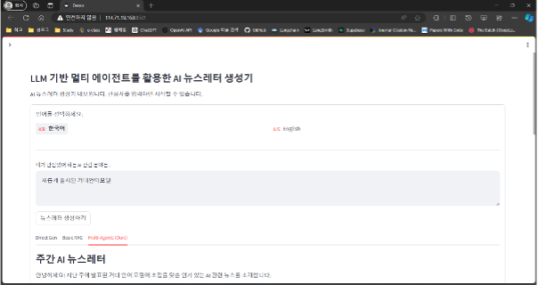
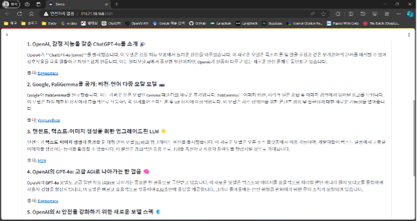

# 📰 AI News Curator

> **Multi-Agent 기반 RAG를 활용하여 사용자의 관심사와 최신 트렌드를 반영한 AI 뉴스레터 자동 생성 시스템**


<p align="center">


</p>

---

# 📖 Overview

최근 LLM을 활용한 뉴스 요약 서비스가 증가하고 있지만, 대부분의 시스템은 검색된 문서의 **관련성(Relevance)** 만 고려하여 뉴스를 생성합니다.

본 프로젝트에서는 기존 RAG(Retrieval-Augmented Generation)의 한계를 개선하기 위해 **화제성(Trendiness)** 을 함께 고려하는 **Multi-Agent 기반 RAG 시스템**을 제안하였습니다.

여러 명의 가상 구독자를 생성하여 각각의 관점에서 관심 있는 뉴스를 선택하도록 한 뒤, 이를 기반으로 뉴스를 선별하고 최종 뉴스레터를 생성합니다.

이를 통해 단순히 정확한 뉴스가 아닌, **많은 사람들이 관심을 가질 만한 뉴스레터**를 생성하는 것을 목표로 합니다.

---

# ✨ Features

- 🔍 DuckDuckGo 기반 최신 뉴스 검색
- 🤖 다양한 역할의 가상 구독자(Multi-Agent) 생성
- 📝 Pre-survey를 통한 관심 기사 조사
- 📚 RAG 기반 뉴스 요약
- 📰 Markdown 형태 뉴스레터 자동 생성
- 💻 Streamlit 기반 Demo 제공

---

# 🏗️ System Architecture

<p align="center">

</p>

프로젝트는 다음과 같은 순서로 동작합니다.

```text
User Topic
      │
      ▼
Web Search
      │
      ▼
Virtual Subscribers
      │
      ▼
Pre-Survey
      │
      ▼
News Curation
      │
      ▼
RAG Generation
      │
      ▼
Newsletter
```

---

# ⚙️ Tech Stack

| Category | Technology |
|----------|------------|
| Language | Python |
| LLM | GPT-4o, GPT-3.5 Turbo |
| Framework | LangChain, LangGraph |
| Search Engine | DuckDuckGo Search API |
| Embedding | OpenAI Embedding |
| Vector Store | FAISS |
| UI | Streamlit |

---

# 📂 Project Structure

```bash
.
├── agent/
│   ├── direct_generation.py
│   ├── basic_rag.py
│   └── multi_agents.py
│
├── lib/
│   ├── prompt.py
│   └── utils.py
│
├── app.py
├── requirements.txt
├── README.md
│
└── docs
    ├── images
    └── result
```

---

# 🚀 Workflow

### 1. Topic 입력

사용자가 관심 있는 주제를 입력합니다.

```
Artificial Intelligence
```

↓

### 2. Web Search

DuckDuckGo Search API를 이용하여 최신 뉴스를 수집합니다.

↓

### 3. Multi-Agent Survey

다양한 배경의 가상 구독자를 생성합니다.

예시

- AI Researcher
- Software Engineer
- ML Developer
- Journalist
- Product Manager

각 구독자는 자신이 가장 흥미롭게 생각하는 뉴스를 선택합니다.

↓

### 4. News Curation

다수의 Agent가 선택한 뉴스를 기반으로

중복을 제거하고

최종 기사 후보를 선정합니다.

↓

### 5. Newsletter Generation

선정된 기사들을 이용하여

Markdown 뉴스레터를 생성합니다.

---

# 📊 Experiment

총 **11명의 평가자**를 대상으로 다음 세 가지 방법을 비교하였습니다.

- Direct Generation
- Basic RAG
- Proposed Multi-Agent

평가 항목은 다음과 같습니다.

- Relevance
- Verifiability
- Recentness
- Non-redundancy
- Interest

---

# 📈 Result

| Method | Interest Score |
|---------|---------------:|
| Direct Generation | 2.73 |
| Basic RAG | 2.64 |
| **Multi-Agent (Ours)** | **3.36** |

기존 RAG 대비 **약 20% 높은 관심도(Interest)** 를 기록하였으며,

신뢰성과 최신성 역시 유지하는 결과를 확인하였습니다.

<p align="center">

</p>

---

# 💻 Demo

<p align="center">

</p>

<p align="center">

</p>

사용자는 관심 있는 주제를 입력하면,

최신 뉴스를 검색하고,

Multi-Agent가 뉴스를 선별한 뒤,

최종 뉴스레터를 자동으로 생성합니다.

---

# 📌 Example Output

```markdown
## Weekly AI Newsletter

### OpenAI releases new GPT model

...

Source:
https://...
```

---

# 👨‍💻 Team

| Name | Role |
|------|------|
| 홍승범 | Multi-Agent / RAG |
| 차승언 | Research / Evaluation |

---

# 📚 References

- LangChain
- LangGraph
- OpenAI API
- DuckDuckGo Search API
- FAISS

---

# 📄 License

This project was developed for **Capstone Design II** at **Seoul National University of Science and Technology**.

For academic purposes only.
